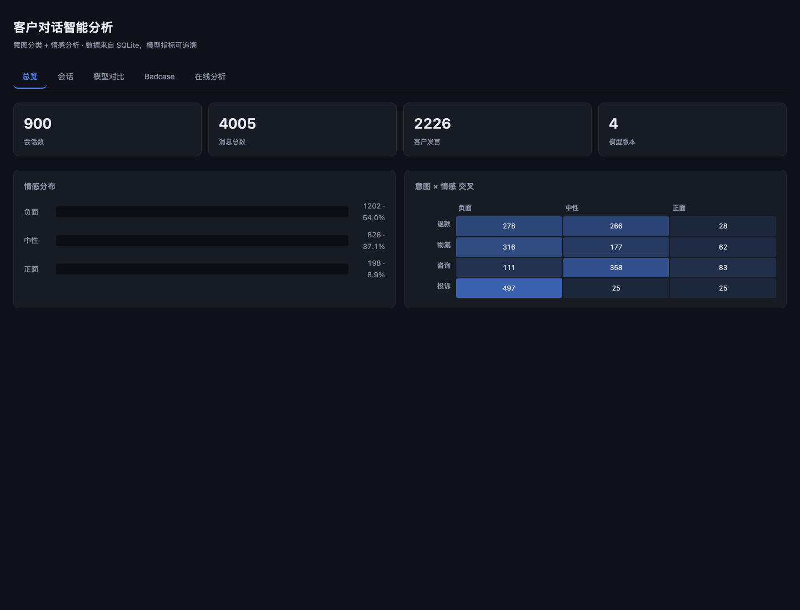

# 客户对话智能分析平台

[](https://github.com/chenzheng0809-gif/customer-voice/actions/workflows/ci.yml)

把电商客服的对话记录变成**可追溯、可对比**的意图与情感分析结果，并配一个能交互的 Web 看板。

> 核心不是"能分类"，而是**每个数字都说得清来路**：预测结果带模型版本和置信度入库，
> baseline 与微调模型跑同一套无泄漏测试集，指标并排放。



*总览页：会话/消息计数、情感分布、意图 × 情感交叉表。所有数字来自 SQLite，
前端不硬编码任何值。*

## 和其他项目的关系

同一个 GitHub 账号下还有一个 [`crossborder-review-analytics`](https://github.com/chenzheng0809-gif/crossborder-review-analytics)，
两者都用 OCR + 情感分析 + SQLite + 原生 JS，但**解决的问题不同**：

| | crossborder-review-analytics | **本项目 customer-voice** |
|---|---|---|
| 场景 | 跨境电商 5 站点 × 6 语言 | 中文客服单场景 |
| 核心难点 | 多语言、多源接入、脏数据清洗（去重/时区/繁简） | **模型评测的严谨性** |
| 数据 | 真实接口导出 + 买家截图 | 合成对话 + 公开语料 ChnSentiCorp |
| 重心 | 数据流管道、i18n | 数据泄漏排查、回归测试、多口径指标对照 |
| 一句话 | "瓶颈不是框架，是数据流的正确性" | "瓶颈不是能不能分类，是指标可不可信" |

两个项目互补：前者解决"数据怎么接进来"，后者解决"接进来之后模型到底靠不靠谱"。

---

## 克隆后怎么跑

仓库不含模型权重、数据集和 SQLite 数据库（见 `.gitignore`），需要本地生成。
按顺序执行即可，全程约 20 分钟（CPU）：

```bash
git clone <this-repo> && cd customer-voice
python3 -m venv .venv && source .venv/bin/activate
pip install -r requirements.txt

source src/env_hf.sh                  # HF 镜像 + 缓存路径

PYTHONPATH=src python src/build_dataset.py   # 1. 生成合成对话
PYTHONPATH=src python src/build_db.py        # 2. 建 SQLite 库
PYTHONPATH=src python src/train_eval.py --fast   # 3. baseline（秒级，可先看效果）
PYTHONPATH=src python src/final_train.py     # 4. BERT 微调（约 15 分钟）
PYTHONPATH=src python src/server.py          # 5. 看板 http://127.0.0.1:8765/
```

想跑「真实语料」部分，先按 [`data/DATA_SOURCES.md`](data/DATA_SOURCES.md) 下载
ChnSentiCorp，再执行 `src/import_external.py`。

---

## 一句话能力对照

| 岗位要求 | 项目落点 | 可验证产出 |
|---|---|---|
| pandas / numpy / scipy | 数据生成与面板分析、McNemar 精确检验 | `build_dataset.py`、`train_eval.py` |
| 数据结构与算法 | 事件委托、懒加载、字符 n-gram 倒排特征 | `web/app.js`、`model.py` |
| transformers 结构 | BERT 微调（分层学习率 + warmup + 早停） | `model.py: TransformerCLS` |
| 分类 / 情感分析 | 意图 4 分类 + 情感 3 分类 | `reports/metrics.csv` |
| OCR | 客户截图 → 文本 → 同一分析管线 | `ocr_pipeline.py` |
| JS 前端 | 零框架看板，5 个视图 | `web/` |
| 关系数据库 / SQL | SQLite 四表 3NF + 窗口函数/自连接查询 | `db/queries.sql` |
| 机器学习 | baseline vs 微调、混淆矩阵、badcase 分析 | `reports/`、看板 |

### OCR 支线

截图 → OCR → 结构化（识别说话人、过滤时间戳/标题）→ 与文本走**同一条**分析管线。

合成聊天截图的实测：

| 图像条件 | OCR 置信度 | 识别条数 |
|---|---|---|
| 原图 | 0.995 | 4/4 正确 |
| 高斯模糊 1.2 | 0.995 | 4/4 正确 |
| 二分之一降采样再放大 | 0.984 | 4/4 正确 |

设计要点：字体按候选列表探测（PingFang 在部分 macOS 上不存在，
加载失败会静默画成方框、OCR 再识别成 `000000`）；聊天界面的标题栏/时间戳
必须过滤，否则"客户咨询"这种标签会被当成客户发言并判成负面情绪。

---

## 快速开始

```bash
# 1. 环境（项目依赖根目录的 .venv）
cd customer-voice
export HF_ENDPOINT=https://hf-mirror.com            # 国内访问 HF 需镜像
export HF_HOME=$(cd .. && pwd)/.hf_cache            # 缓存放工作区，避免权限问题

# 2. 全流程
PYTHONPATH=src python3 src/build_dataset.py --n 600   # 生成数据
PYTHONPATH=src python3 src/build_db.py                # 建库入库
PYTHONPATH=src python3 src/train_eval.py              # 训练 + 评测 + 预测入库

# 3. 看板
PYTHONPATH=src python3 src/server.py                  # http://127.0.0.1:8765/

# 4. OCR 支线
PYTHONPATH=src python3 src/ocr_pipeline.py --demo
```

没有 GPU、只想快速看 baseline 时用 `train_eval.py --fast`（秒级）。

---

## 目录

```
customer-voice/
├── src/
│   ├── schema.py           标签体系与字段约定（单一事实来源）
│   ├── build_dataset.py    合成对话生成（按主体句切分 train/val/test）
│   ├── build_db.py         SQLite 建表与导入
│   ├── model.py            baseline + BERT 微调，统一 predict 接口
│   ├── train_eval.py       训练/评测/显著性检验/入库
│   ├── ocr_pipeline.py     截图 → 文本 → 结构化 → 分析
│   └── server.py           标准库 HTTP 服务 + JSON API
├── web/                    看板（HTML/CSS/vanilla JS）
├── db/
│   ├── customer_voice.sqlite
│   └── queries.sql         8 条核心查询，标注 SQL 知识点
├── data/                   生成的数据 + OCR 演示图
├── reports/                指标与混淆矩阵
└── INTERVIEW.md            面试问答准备
```

---

## 数据设计（这个项目最关键的部分）

### 为什么用合成数据

真实客服数据涉及用户隐私，实习场景拿不到；合成数据的价值是**能精确控制难度梯度**：
数据里显式混入了「礼貌型投诉」（"您这边服务真是让我大开眼界"）、
「中性措辞带负面」（"好的我收到了，那大概什么时候能解决"）这类硬样本。

### 如何避免指标虚高 —— 踩坑记录

| 版本 | 做法 | baseline 意图 acc | 问题 |
|---|---|---|---|
| v1 | 49 个整句模板 → 989 条 | **100%** | 一句复用 20 次，模型直接背句子 |
| v2 | 160+ 片段，开场+主体+结尾组合，唯一率 80% | **100%** | 主体句仍原封不动跨集复用 |
| v3 | **按主体句划分 split**，`train ∩ test = 0` | **68.5%** | 可信起点 |

结论：隔离粒度必须是**句子级**，按会话或按消息切分都不够。
`build_dataset.py` 末尾有自动的泄漏校验（集合交集为 0）。

---

## 模型

**最终结果**（测试集 371 条，全程不参与训练/调参；固定种子 42）

| 任务 | baseline (TF-IDF+LinearSVC) | 微调 (bert-base-chinese) | 分布外 | 真实语料 |
|---|---|---|---|---|
| 意图分类（4 类） | 74.9% / F1 0.745 | **86.7% / F1 0.868** | 75% | — |
| 情感分析（3 类） | 66.8% / F1 0.456 | **84.8% / F1 0.821** | 85% | **91.2%** |

情感训练集 = 合成 1,844 条 + **公开标注语料 ChnSentiCorp 3,000 条**。
真实语料的作用（对照实验）：

| 训练数据 | 客服测试集 | 真实酒店评论 |
|---|---|---|
| 纯合成 | 87.7% | 79.3% |
| +3,000 条真实评论 | 85.9% | **90.8%** |

**真实场景 +11.5pt，客服场景 -1.8pt** —— 用一点场景内指标换来了大幅泛化提升。

> baseline 情感 macro-F1 只有 0.456：程度副词样本（"好差/好烂"）让字符 n-gram 完全失效，
> 这正是需要预训练模型的地方。

McNemar 精确检验：意图 p < 0.0001，情感 p = 0.0011，提升均显著。

**必须如实说明的短板**（面试时主动讲，比被问出来好）：
- 情感：负面召回 **92.8%**（修完程度副词 bug 后从 75.1% 提升）
- 意图：**投诉召回 74.5%** —— 投诉被系统性地判成物流（两类话术本就重叠）
- 意图"咨询"recall 98.9% 是位置优势（吸走不确定样本），precision 只有 79.3%
- 同一配置多次运行的波动约 ±2 个点，小数据集上的正常现象

详细混淆矩阵、调参记录、badcase 分析见 [`reports/REPORT.md`](reports/REPORT.md)。

### 回归测试：程度副词 bug

用户反馈"**客服态度好差**"被判成正面（0.97 置信度）。根因不是程度副词本身，
而是训练集里"客服态度很好"这条正面模板被复用 12 次以上，
让模型把"客服态度"和正面绑定死了。

修复：拆高频模板 + 补负面样本 + 归一化兜底层。回归测试
`src/test_sentiment_regression.py` **22/22 通过**：

```bash
PYTHONPATH=src python3 src/test_sentiment_regression.py -v
```

微调时踩过的坑：
- 统一 lr=2e-5 时分类头学不动，置信度挤在 0.4~0.55 → 改**分层学习率**（head ×10）
- 小数据下 2 epoch 就把训练集背下来（loss 0.0005，置信度全 1.0）
  → 加 dropout 0.3 + warmup + 梯度裁剪
- 小验证集（382 条）上的早停信号不可靠，用测试集做 1/2/3 epoch 对照，确认 **2 epoch 最优**
- 情感三类不均衡，用 **macro-F1** 而非 accuracy 作主指标

---

## 数据库

四张表 3NF：`sessions` / `messages` / `predictions` / `evaluations`。
预测与标注**分表**，使多模型结果可以并挂，自连接即可做 A/B 对比。

`db/queries.sql` 里 8 条查询覆盖：条件聚合、HAVING 过滤、自连接、
`RANK()`、`ROW_NUMBER()`、执行计划、事务。

---

## 前端

纯 HTML/CSS/JS，无框架，5 个视图：总览 / 会话列表（可筛高风险）/ 模型对比 /
Badcase / 在线分析。

实现要点：事件委托（避免逐行绑监听）、视图懒加载、用户输入 HTML 转义、
数据全部经 API 从 SQLite 读取（前端零硬编码数字）。

---

## 已知局限

- 合成数据与真实客服话术有分布差距，真实数据上指标会下降
- 未利用对话上下文（"那这个呢"这类依赖前文的消息会判错）
- 模型在进程内加载，未做服务化与批量推理
- OCR 支线只做了合并单元格与简单说话人识别，复杂版式未覆盖